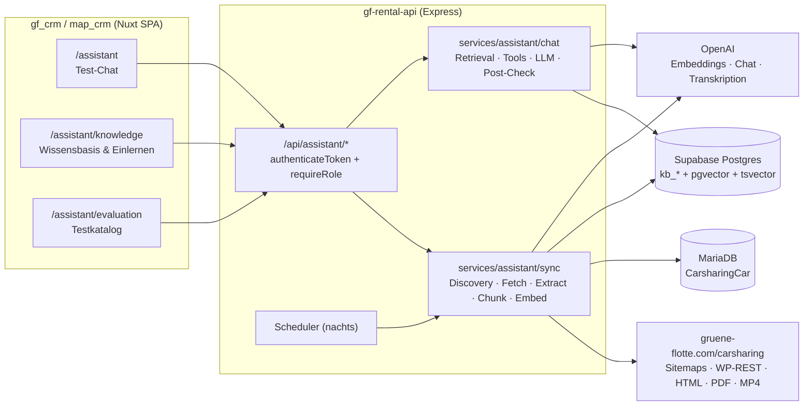
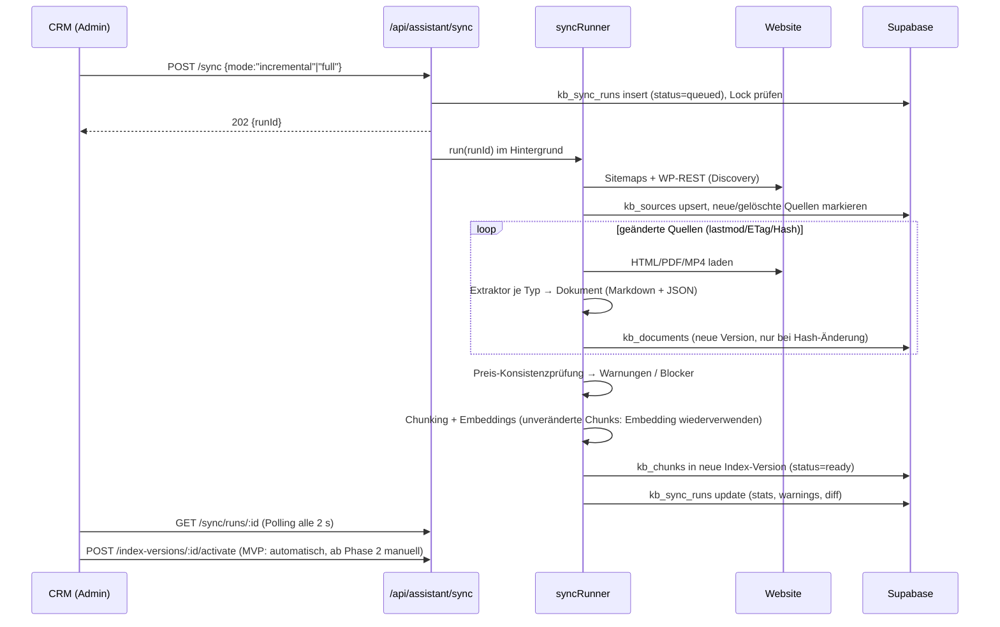
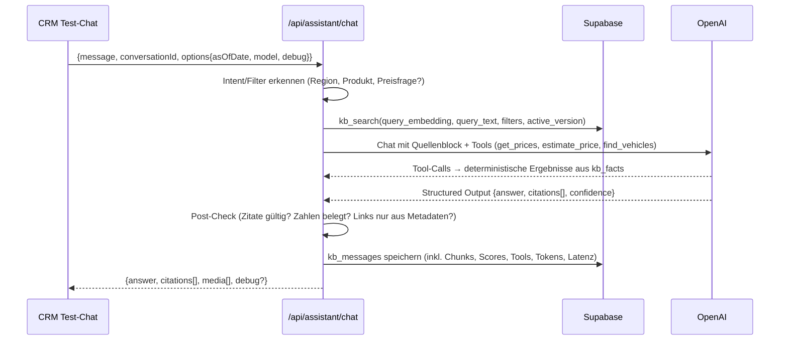

# Umsetzungskonzept: Carsharing-Assistent (Website einlernen + interner Test-Chat im CRM)

Stand: 08.10.2026
Fachliche Grundlage (Parsing-Regeln, Chunk-Modell, Anti-Halluzination): [`service-knowledge-hub/docs/konzept-rag-website-carsharing.md`](../../service-knowledge-hub/docs/konzept-rag-website-carsharing.md)
Dieses Dokument beschreibt **wo was gebaut wird**, die Datenmodelle, Endpunkte, CRM-Oberflächen und die Phasen bis zum internen Test.

---

## 1. Ziel und Abgrenzung

**Ziel MVP (intern):** Mitarbeitende (Rollen `ADMIN`, `SELLER`) können im CRM `gf_crm/map_crm`

1. die Website `gruene-flotte.com/carsharing` per Knopfdruck **einlernen** (crawlen → parsen → chunken → indexieren) und sehen, was sich geändert hat,
2. in einem **Test-Chat** Fragen rund ums Carsharing stellen und Antworten **mit Quellen** (Seite + Abschnitt, PDF + Seite, Video + Zeitmarke) erhalten,
3. jede Antwort **bewerten** (👍/👎, Kommentar, erwartete Antwort), damit daraus ein Testkatalog entsteht,
4. im **Debug-Modus** sehen, welche Chunks/Tools die Antwort erzeugt haben.

**Nicht im MVP:** öffentliches Website-Widget, Live-Stationsverfügbarkeit, Zusammenführung mit dem Hilfe-Center-Bot (`service-knowledge-hub`) – das kommt in Phase 3.

---

## 2. Architekturentscheidung

| Baustein | Entscheidung | Begründung |
|---|---|---|
| **Backend (Einlernen + Chat)** | `gf-rental-api`, neues Modul `services/assistant/` + Route `/api/assistant/*` | Das CRM spricht bereits über `crmApiFetch` (Cookie-Session, `VITE_API_URL`) mit dieser API; Auth (`authenticateToken`, `requireRole`), OpenAI-Client, Scheduler-Muster (`followupScheduler`) und die Fahrzeugdaten (`CarsharingCar`) liegen schon hier |
| **Vektor-Datenbank** | **Supabase** (bestehendes Projekt, eigene Tabellen mit Präfix `kb_`) | MariaDB hat kein pgvector bzw. keine deutsche Volltextsuche; Supabase ist bereits eingerichtet. Eigene `kb_`-Tabellen lassen den bestehenden Hilfe-Center-Bot (`rag_chunks`) unberührt |
| **DB-Zugriff aus der API** | `@supabase/supabase-js` mit Service-Role-Key (wie im Knowledge-Hub) | Kein DB-Passwort nötig; atomares Umschalten der Index-Version und Hybrid-Suche laufen als SQL-Funktionen (`kb_activate_index_version`, `kb_search`) |
| **LLM / Embeddings** | OpenAI (wie bisher), Modelle per ENV konfigurierbar, im Test-Chat umschaltbar | Bereits im Einsatz (`openai` in API und Knowledge-Hub); Embeddings `text-embedding-3-small` (1536 Dim.) – kompatibel zum Knowledge-Hub |
| **Frontend** | `gf_crm/map_crm`: neue Seiten unter `/assistant`, `utils/assistantApi.ts`, `stores/assistant.ts` | Gleiches Muster wie `utils/chatbotApi.ts`, `utils/feedbackApi.ts` |
| **Route-Name** | `/api/assistant` (nicht `/api/chatbot`) | `/api/chatbot` ist bereits für die Feedback-Zusammenfassung belegt |

> **Abweichung vom ersten Konzept:** Die dort vorgeschlagenen Markdown-Snapshots im Git-Repo werden durch **versionierte Dokumente in der Datenbank + Diff-Ansicht im CRM** ersetzt, da das Einlernen auf dem Server per Knopfdruck läuft. Die Review-Idee bleibt: Ein neuer Index wird erst nach Prüfung aktiv (ab Phase 2).



---

## 3. Backend: Modulstruktur in `gf-rental-api`

```
services/assistant/
  config.js                 # ENV, Scope-Regeln (Include/Exclude), Modellnamen
  db.js                     # pg-Pool für Supabase
  sync/
    syncRunner.js           # Orchestrierung eines Laufs, Lock, Status, Statistik
    discovery.js            # Sitemaps + WP-REST → Quellenliste (URL, wp_id, lastmod, robots)
    fetcher.js              # axios, 1 req/s, If-Modified-Since/ETag, eigener User-Agent
    extractors/
      generic.js            # Divi-HTML → Markdown-Blöcke (cheerio + turndown), Dedup, Boilerplate
      faq.js                # .custom-faq-* → Q/A inkl. Kategorie + Keywords
      toggles.js            # .et_pb_toggle → Q/A
      prices.js             # Inline-JS (const tables, basisTarif) → JSON (acorn), Gültigkeit
      vehicles.js           # aus MariaDB: CarsharingCar inkl. pageBlocks (kein Scraping)
      pdf.js                # Textextraktion je Seite, Versionsfamilien
      video.js              # MP4 → OpenAI-Transkription mit Segmenten (Cache per ETag)
    consistency.js          # Preis-Abgleich (Tabelle ↔ Kalkulator ↔ Preisliste) → Warnungen/Blocker
    chunker.js              # Strukturbasiertes Chunking, Kontext-Präfix, stabile IDs
    embedder.js             # Batch-Embeddings, Wiederverwendung per content_hash
    indexer.js              # Schreibt kb_documents/kb_chunks in neue Index-Version
    scheduler.js            # Nächtlicher inkrementeller Lauf (ASSISTANT_SYNC_ENABLED)
  chat/
    retrieval.js            # Hybrid-Suche (SQL-Funktion kb_search), Filter, Boosts
    tools.js                # get_prices, estimate_price, find_vehicles (deterministisch)
    prompt.js               # System-Prompt, Quellenblock
    answer.js               # LLM-Aufruf (Structured Output), Post-Check, Fallback
    postCheck.js            # Zitat-, Zahlen- und Link-Prüfung
controllers/assistant/
  chatController.js  knowledgeController.js  syncController.js  evalController.js
routes/assistant/assistantRoute.js
```

Neue Abhängigkeiten: `pg`, `cheerio`, `turndown`, `acorn`, `pdfjs-dist` (bzw. `unpdf` per dynamischem `import()`, da ESM-only). `axios` und `openai` sind vorhanden.

### 3.1 Ablauf „Einlernen“ (Sync-Run)



- **Lock:** Es läuft maximal ein Sync gleichzeitig (Zeile in `kb_sync_runs` mit `status in (queued, running)`).
- **Robustheit bei Neustart der API:** Läufe im Status `running`, deren `heartbeat_at` älter als 5 Min. ist, werden beim Start auf `failed` gesetzt.
- **Kosten:** Ein Full-Sync mit ca. 3.000–5.000 Chunks liegt bei den Embeddings im Cent-Bereich; die Transkription der Videos fällt nur einmalig (bzw. bei Änderung) an. Deshalb wird pro Lauf eine **komplett neue Index-Version** aufgebaut – einfach, atomar umschaltbar und rückrollbar.

### 3.2 Ablauf „Chat“



---

## 4. Datenmodell (Supabase, Migrationen im Knowledge-Hub-Projekt oder eigenem Ordner)

| Tabelle | Zweck | Wichtige Felder |
|---|---|---|
| `kb_sources` | Inventar aller gefundenen Quellen | `id`, `url`, `type` (`page`,`post`,`faq`,`pdf`,`video`,`vehicle`), `wp_id`, `title`, `enabled`, `excluded_reason`, `robots`, `lastmod`, `etag`, `last_seen_at`, `deleted_at` |
| `kb_documents` | Versionierte, normalisierte Inhalte je Quelle (Basis für Diff) | `id`, `source_id`, `version`, `markdown`, `extracted` (jsonb), `content_hash`, `sync_run_id`, `created_at` |
| `kb_index_versions` | Atomarer Wechsel und Rollback | `id`, `status` (`building`,`ready`,`active`,`archived`,`failed`), `sync_run_id`, `stats`, `activated_by`, `activated_at` |
| `kb_chunks` | Such-Einheiten | `chunk_id` (stabil), `index_version_id`, `document_id`, `kind`, `title`, `question`, `content`, `embed_text`, `embedding vector(1536)`, `fts tsvector` (german), `source_url` (inkl. Anker/`#page=`/`#t=`), `breadcrumb`, `authority`, `status`, `valid_from`, `valid_until`, `published_at`, `region[]`, `audience[]`, `product[]`, `keywords[]`, `media jsonb`, `trust`, `content_hash` |
| `kb_facts` | Strukturierte Fakten für Tools | `key` (`price_tables`, `fuel_surcharge`, `card_options`, …), `version`, `valid_from`, `valid_until`, `status`, `data jsonb`, `source_url`, `index_version_id` |
| `kb_sync_runs` | Protokoll jedes Einlernens | `id`, `mode`, `status`, `triggered_by`, `started_at`, `finished_at`, `heartbeat_at`, `stats` (neu/geändert/gelöscht/Chunks/Kosten), `warnings jsonb`, `error` |
| `kb_conversations` / `kb_messages` | Test-Chat-Verläufe | `user_id` (CRM-User), `role`, `content`, `citations jsonb`, `retrieved jsonb` (Chunk-IDs + Scores), `tool_calls jsonb`, `model`, `index_version_id`, `as_of_date`, `latency_ms`, `tokens` |
| `kb_feedback` | Bewertungen aus dem Test-Chat | `message_id`, `user_id`, `rating` (+1/−1), `reason` (`falsch`,`unvollständig`,`falsche Quelle`,`veraltet`,`sonstiges`), `comment`, `expected_answer` |
| `kb_eval_cases` / `kb_eval_runs` | Testkatalog und Ergebnisse | `question`, `expected_answer`, `expected_sources[]`, `must_contain[]`, `must_refuse`; je Lauf: Score, Recall@5, Fehlerliste |

SQL-Funktion `kb_search(query_embedding, query_text, filters jsonb, match_count, as_of date)`:
- Vektor-Treffer (Top 30) + Volltext-Treffer `websearch_to_tsquery('german', …)` (Top 30) → **Reciprocal Rank Fusion**,
- nur `index_version = aktive Version`, `status = 'active'` bzw. `valid_from <= as_of <= valid_until`,
- Boost nach `authority`, Zeit-Decay für `kind = 'news'`,
- liefert die Top N (Standard 6) mit Scores für das Debug-Panel.

Zugriff: RLS an, nur Service-Role/DB-User der API; keine Rechte für `anon`/`authenticated` (wie bei `rag_chunks`).
Aufbewahrung: Chat-Verläufe nach 90 Tagen löschen (Cron in `scheduler.js`), Feedback mit `expected_answer` bleibt als Testfall erhalten (ohne Personenbezug).

---

## 5. API-Endpunkte (`/api/assistant`, alle mit `authenticateToken`)

| Methode | Pfad | Rolle | Beschreibung |
|---|---|---|---|
| POST | `/chat` | ADMIN, SELLER | Frage stellen. Body: `message`, `conversationId?`, `options { debug, asOfDate, model, topK }` → `answer`, `citations[]`, `media[]`, `messageId`, `debug?` |
| GET | `/conversations` / `/conversations/:id` | ADMIN, SELLER | Eigene Verläufe |
| POST | `/messages/:id/feedback` | ADMIN, SELLER | 👍/👎, Grund, Kommentar, erwartete Antwort |
| POST | `/search` | ADMIN | Nur Retrieval (ohne LLM): Treffer mit Scores – zum Prüfen der Suche |
| GET | `/sources` | ADMIN | Quellen mit Status, Chunk-Anzahl, letztem Crawl |
| PATCH | `/sources/:id` | ADMIN | Quelle ein-/ausschließen |
| POST | `/sync` | ADMIN | Einlernen starten (`incremental` / `full`, optional `sourceIds[]`) → `202 {runId}` |
| GET | `/sync/runs` / `/sync/runs/:id` | ADMIN | Status, Fortschritt, Statistik, Warnungen, Diff |
| GET | `/documents/:id/diff?against=prev` | ADMIN | Text-Diff zweier Dokumentversionen |
| GET | `/index-versions` | ADMIN | Versionen mit Status |
| POST | `/index-versions/:id/activate` | ADMIN | Version aktiv schalten (auch Rollback) |
| GET | `/chunks` | ADMIN | Chunk-Browser (Filter: kind, source, Text) |
| GET/POST | `/eval/cases`, `/eval/runs` | ADMIN | Testkatalog pflegen, Lauf starten, Ergebnisse |

Rate-Limit für `/chat`: z. B. 30 Anfragen/Min. pro User (`express-rate-limit` ist vorhanden).
Antwort im MVP ohne Streaming; Streaming (SSE) in Phase 2, falls die Wartezeit stört.

---

## 6. Antwortlogik gegen Halluzinationen (konkret)

1. **Structured Output** des LLM (JSON-Schema):
   ```json
   { "answer_markdown": "… [1] … [2]", "citations": [{"n":1,"chunk_id":"…"}], "confidence": "high|low|none", "follow_ups": ["…"] }
   ```
2. **Quellenblock im Prompt** mit nummerierten Chunks (Titel, Breadcrumb, Gültigkeit, Inhalt). Regeln: nur daraus antworten, jede Sachaussage belegen, bei fehlender Quelle `confidence: none` → Standardantwort mit Kontaktweg.
3. **Tools statt Freitext für Zahlen:** `get_prices(tariff, vehicle_class, as_of)`, `estimate_price(class, tariff, start, end, km)` (gleiche Logik wie der Website-Kalkulator inkl. Bestpreis), `find_vehicles(filter)`. Tool-Ergebnisse tragen ihre Quelle (`source_url`) und gelten als zitierfähig.
4. **Post-Check (serverseitig):**
   - jedes `[n]` verweist auf einen tatsächlich gelieferten Chunk,
   - jede Zahl/€-Angabe/jedes Datum der Antwort kommt in einem zitierten Chunk oder Tool-Ergebnis vor,
   - Links werden ausschließlich aus `source_url`/`media` der zitierten Chunks gebaut – vom Modell erzeugte URLs werden entfernt.
   Bei Verstoß: einmal neu generieren mit Hinweis, sonst Fallback-Antwort („Dazu habe ich keine gesicherte Angabe – siehe [Preisliste]“).
5. **Stichtag (`asOfDate`)** im Test-Chat einstellbar → so lässt sich z. B. prüfen, ob ab dem Stichtag die Preise „ab Oktober 2026“ ausgespielt werden.

---

## 7. CRM-Oberflächen (`gf_crm/map_crm`)

Neuer Sidebar-Eintrag **„KI-Assistent“** (in `components/AppSidebar.vue`) mit Unterpunkten:

### 7.1 `/assistant` – Test-Chat (ADMIN, SELLER)
- Chatverlauf links (eigene Konversationen), Chat in der Mitte.
- Antworten als Markdown mit hochgestellten Quellennummern; darunter **Quellenkarten**:
  - Seite: Titel, Breadcrumb, Link mit Anker,
  - PDF: Dateiname + Seite (`…pdf#page=3`),
  - Video: Poster + Titel; Klick öffnet einen Player an der Zeitmarke (`#t=42`),
  - Tool-Ergebnis: z. B. „Preistabelle ab Juni 2026“ mit Link.
- Leiste über dem Eingabefeld: Modell, Stichtag, Top-K, **Debug an/aus**.
- **Debug-Panel** (aufklappbar): gefundene Chunks mit Score (Vektor/Volltext/fusioniert), Tool-Calls mit Ein-/Ausgabe, Post-Check-Ergebnis, Index-Version, Tokens, Latenz.
- Feedback je Antwort: 👍/👎, Grund (Auswahl), Kommentar, „So wäre es richtig“ → optional direkt als Testfall übernehmen.

### 7.2 `/assistant/knowledge` – Wissensbasis (ADMIN)
- Karte **„Website einlernen“**: Buttons *Inkrementell* / *Vollständig*, Fortschrittsanzeige (Phase, x/y Quellen), Ergebnis: neu/geändert/entfernt, Chunks, Kosten, **Warnungen** (fiktives Beispiel: „Preis XS 7–24 Uhr: Tabelle 1,80 € ≠ Kalkulator 1,70 €“).
- Liste der Sync-Läufe; Detailansicht mit **Diff je Dokument**.
- Index-Versionen mit „Aktivieren“ / „Zurückrollen“.
- Quellenliste mit Filter (Typ, Status), Schalter „einbeziehen“, Link zur Live-Seite, Anzahl Chunks.
- Chunk-Browser + „Suche testen“ (nur Retrieval, ohne LLM).

### 7.3 `/assistant/evaluation` – Testkatalog (ADMIN, Phase 2)
- Testfälle (aus FAQ generiert, aus Feedback übernommen, manuell), Lauf starten, Ergebnis je Fall (bestanden/nicht bestanden, Abweichung, Quellen).

Technik Frontend: `utils/assistantApi.ts` (auf Basis von `crmApiFetch`), `stores/assistant.ts` (Pinia), Komponenten unter `components/assistant/` (`ChatWindow.vue`, `ChatMessage.vue`, `SourceCard.vue`, `DebugPanel.vue`, `FeedbackForm.vue`, `SyncRunCard.vue`, `DocumentDiff.vue`, `ChunkBrowser.vue`), Markdown-Rendering mit Sanitizing (z. B. `markdown-it` + `dompurify` wie im Knowledge-Hub). Admin-Seiten mit `middleware: "admin"`.

---

## 8. Inbetriebnahme & Konfiguration (umgesetzt)

1. **Migration** im bestehenden Supabase-Projekt ausführen:
   `service-knowledge-hub/supabase/migrations/20261008120000_create_kb_assistant.sql`
   (per `supabase db push` oder im SQL-Editor).
2. **ENV in `gf-rental-api/.env`** ergänzen:
   ```
   ASSISTANT_SUPABASE_URL=…                 # wie SUPABASE_URL im Knowledge-Hub
   ASSISTANT_SUPABASE_SERVICE_ROLE_KEY=…    # nur serverseitig
   # optional
   ASSISTANT_CHAT_MODELS=gpt-4o-mini,gpt-5-mini,gpt-5.4-mini   # Auswahl im Test-Chat
   ASSISTANT_CHAT_MODEL=gpt-4o-mini                             # Standard
   ASSISTANT_TOP_K=6
   ASSISTANT_MIN_SIMILARITY=0.3
   ASSISTANT_STRICT_POST_CHECK=true        # unbelegte Zahlen → Antwort wird blockiert
   ASSISTANT_SYNC_ENABLED=false            # nächtliches Einlernen (Phase 2)
   ASSISTANT_VEHICLE_URL_TEMPLATE=https://gruene-flotte.com/carsharing/flotte/   # {id} möglich
   ```
   `OPENAI_API_KEY` ist bereits gesetzt.
3. API neu starten, im CRM unter **KI-Assistent → Wissensbasis** auf **„Website einlernen“** klicken
   (alternativ `node scripts/assistant-sync.js --mode full`).
4. Ohne Supabase/OpenAI testen: `node scripts/assistant-sync.js --dry-run --out /tmp/assistant` schreibt Quellen, Chunks, Fakten und Warnungen als Dateien.

Scope-Regeln (Ausschlüsse, Video-Titel, Autorität) liegen in `services/assistant/config.js`; einzelne Quellen lassen sich im CRM unter „Quellen“ auf „immer“/„nie“ stellen.

## 9. Phasen & Aufwand (grobe Schätzung)

| Phase | Inhalt | Ergebnis | Aufwand |
|---|---|---|---|
| **0 – Setup** | Supabase-Migration `kb_*`, `pg`-Anbindung, Route-Gerüst, CRM-Sidebar + leere Seiten | Durchstich steht | 1–2 PT |
| **1 – MVP intern** | Discovery, generischer Extraktor, FAQ, Toggles, Preis-JSON + Konsistenzprüfung, Fahrzeuge aus MariaDB, Chunking, Embeddings, Hybrid-Suche, Chat mit Tools + Post-Check, CRM Test-Chat mit Quellen, Debug & Feedback, manueller Sync-Button | Team kann intern testen | 8–10 PT |
| **2 – Qualität & Medien** | PDFs (Versionsfamilien, Seitenlinks), Videos (Transkription, Zeitmarken), Index-Versionen mit manuellem Aktivieren + Diff, Testkatalog + Evaluationslauf, nächtlicher Sync, Streaming | Belastbare Antworten inkl. Dateien/Videos | 6–8 PT |
| **3 – Ausbau** | Hilfe-Center-Inhalte (`service-knowledge-hub/content`) als weitere Quelle, Source-of-Truth-Regeln, Live-Stationsdaten als Tool, öffentliches Widget (eigene Auth/Rate-Limits/Datenschutz) | Produktivbetrieb | offen |

PT = Personentage, Schätzung ohne Abstimmungs- und Testzeit der Fachseite.

### Abnahmekriterien für den internen Test (Ende Phase 1)
- 30 typische Kundenfragen (Registrierung, Buchen, Fahren, Schaden, Preise, Karten, Flott, Firmenkunden): **≥ 90 % fachlich korrekt** laut Fachseite.
- **Preisfragen: 100 % korrekt** (aus Tool, mit Quelle).
- ≥ 95 % der Antworten mit mindestens einer gültigen Quelle; keine erfundenen Links.
- Fragen außerhalb des Themas oder ohne Quelle → saubere „Weiß ich nicht“-Antwort mit Kontaktweg.
- Einlernen per Knopfdruck < 10 Min. (ohne Video-Transkription), Warnungen werden angezeigt.

---

## 10. Sicherheit & Datenschutz

- Nur eingeloggte CRM-User mit Rolle `ADMIN`/`SELLER`; Verwaltung der Wissensbasis nur `ADMIN`.
- Supabase-Zugangsdaten und OpenAI-Key nur serverseitig; keine Supabase-Keys im CRM-Bundle.
- Im Test-Chat **keine Kundendaten** eingeben (Hinweis in der Oberfläche); Verläufe 90 Tage, dann Löschung.
- Website-Inhalte werden im Prompt als Daten markiert (Schutz vor Prompt-Injection über Inhalte).
- OpenAI: Auftragsverarbeitung/Datenaufbewahrung im Account prüfen; Supabase-Region EU.
- Crawler: eigener User-Agent, Rate-Limit, nur `gruene-flotte.com`.

---

## 11. Offene Entscheidungen

1. **Fahrzeug-Quelle:** Sind die Fahrzeugdaten im CRM (`CarsharingCar` + `pageBlocks`) die führende Quelle, oder noch der WordPress-Post-Type `carsharing` (15 Fahrzeuge)? Empfehlung: CRM.
2. **Preise ab Oktober 2026:** Seit wann gelten sie (Seite ist noch `noindex`)? Bestimmt den Standard-Stichtag.
3. **Supabase-Projekt:** Dasselbe Projekt wie der Hilfe-Center-Bot (Region EU, Pro-Tarif) oder ein eigenes?
4. **Wer gibt neue Index-Versionen frei** (ab Phase 2) und wer pflegt den Testkatalog?
5. **Chat-Modell:** Standardmodell festlegen, nachdem im Test-Chat 2–3 Modelle verglichen wurden (Qualität vs. Kosten/Latenz).
